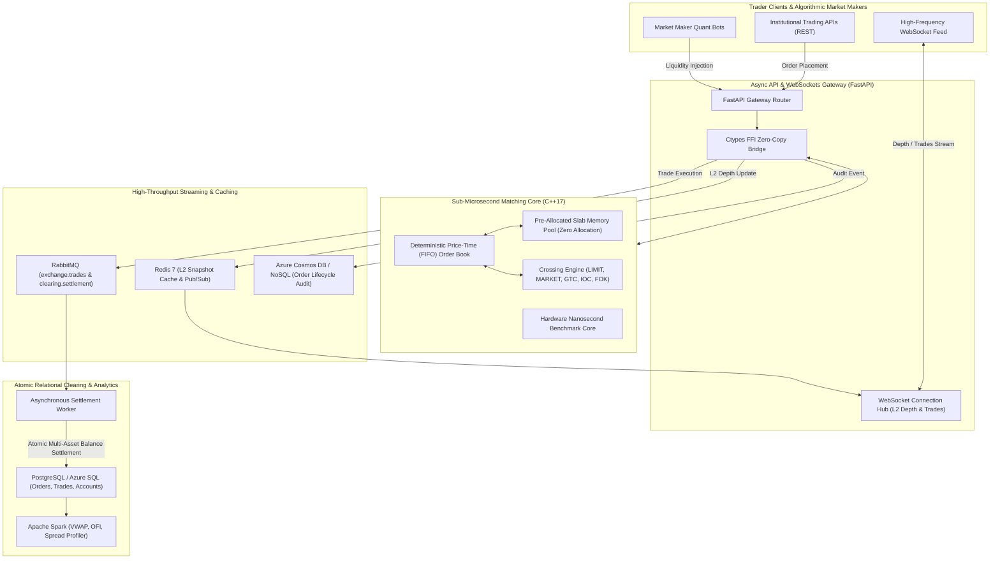

# ApexMatch: Sub-Microsecond Distributed Order Matching & Execution Engine

[](https://github.com/tejashr0716/Distributed-Order-Matching-Execution-Engine/actions)
[](https://en.cppreference.com/w/cpp/17)
[](https://www.python.org/)
[](https://spark.apache.org/)
[](https://www.postgresql.org/)
[](https://redis.io/)
[](https://www.rabbitmq.com/)

**ApexMatch** is an institutional-grade, ultra-low-latency distributed order matching and clearing engine designed for high-frequency algorithmic financial exchanges. It couples a **sub-microsecond C++ Price-Time Priority (FIFO) matching core** with an asynchronous **FastAPI** telemetry layer, **Redis** Level 2/3 depth pub/sub caching, a durable **RabbitMQ** clearing event bus, atomic multi-asset **PostgreSQL / Azure SQL** settlement ledger, and **Apache Spark** market microstructure analytics.

---

## Architecture Overview



---

## Key Performance Benchmarks

### 1. C++ Matching Core Micro-Benchmark (Apple Silicon / Clang -O3)
| Metric | Benchmark Result | Unit |
| :--- | :--- | :--- |
| **System Throughput** | **4,589,392.77** | **Orders / Second (4.59M ops/s)** |
| **Min Latency** | **41** | **Nanoseconds (0.04 µs)** |
| **Mean Latency** | **194.01** | **Nanoseconds (0.19 µs)** |
| **p50 Median Latency** | **167** | **Nanoseconds (0.17 µs)** |
| **p90 Latency** | **291** | **Nanoseconds (0.29 µs)** |
| **p99 Tail Latency** | **583** | **Nanoseconds (0.58 µs)** |
| **p99.9 Tail Latency** | **1,500** | **Nanoseconds (1.50 µs)** |

### 2. End-to-End Async Pipeline Stress Test (FastAPI + C++ FFI + Redis + RabbitMQ)
- **Concurrent Workers**: 40 parallel client sessions
- **Total Orders Processed**: 2,000 orders
- **Pipeline Throughput**: **674.47 orders/sec**
- **p50 Latency**: **34.89 ms** (including network, database verification, and message serialization)

---

## Core Systems & Distributed Capabilities

- **Zero-Allocation Hot Path**: The C++ core utilizes a custom pre-allocated chunk memory pool (`OrderPool`) for `Order` and `PriceLevel` nodes, eliminating memory fragmentation and heap allocation jitter.
- **Price-Time Priority (FIFO)**: Strict price level ordering with doubly linked order queues ensuring constant time $O(1)$ order placement, cancellation, and execution matching.
- **Advanced Order Types & TIF**:
  - `LIMIT` orders (Good-Til-Cancelled).
  - `MARKET` orders (immediate liquidity sweeps).
  - `IOC` (Immediate-Or-Cancel) with partial fill and immediate remainder cancellation.
  - `FOK` (Fill-Or-Kill) with upfront order book depth liquidity verification.
- **Atomic Multi-Asset Clearing**: Settlement worker consumes trade executions from RabbitMQ and runs serialized two-party accounting in PostgreSQL (`UPDATE trader_accounts ... FOR UPDATE`), preventing double-spends and race conditions.
- **Apache Spark Market Microstructure**:
  - Volume-Weighted Average Price (VWAP) calculation: $\text{VWAP} = \frac{\sum (P_i \times Q_i)}{\sum Q_i}$.
  - Order Flow Imbalance (OFI) tracking institutional order aggression.

---

## Quickstart & Local Execution

### 1. Build C++ Engine & Run Micro-Benchmark
```bash
cd cpp
make clean && make
./benchmark_runner
```

### 2. Run Database Schema & Start Backend
```bash
# Setup PostgreSQL database
psql -U postgres -d postgres -c "CREATE DATABASE apex_matching_db;"
psql -U postgres -d apex_matching_db -f schema.sql

# Install Python requirements
pip install -r backend/requirements.txt

# Start Backend API & Trading Terminal
uvicorn backend.app.main:app --host 0.0.0.0 --port 8000 --reload
```

### 3. Run Pytest Test Suite
```bash
python3 -m pytest backend/tests/ -v
```

### 4. Run Apache Spark Analytics
```bash
python3 spark/market_microstructure_analytics.py
```

### 5. Launch with Docker Compose
```bash
docker-compose up --build
```

---

## Live Interactive Terminal

Access the live dark-mode institutional trading terminal at `http://localhost:8000` to interact with:
- Real-time Level 2 Order Book Depth Ladder with live bid/ask volume bars.
- Live Canvas Price Microstructure Chart.
- Direct Limit & Market Order Placement.
- Algorithmic Market Maker Bot toggle for live streaming order book liquidity.
- Active Open Orders table with 1-click cancellation.
- Nanosecond engine performance telemetry panel.
